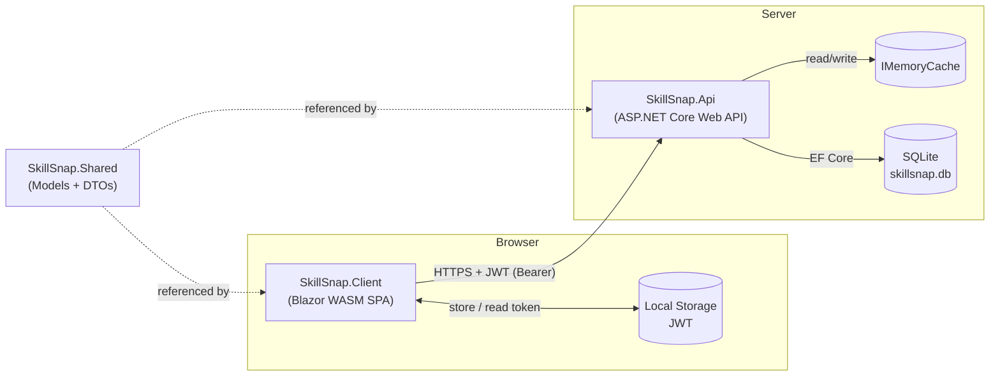
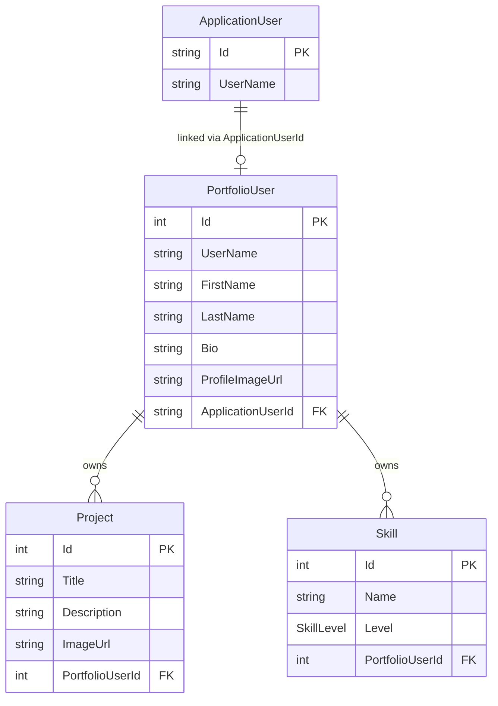
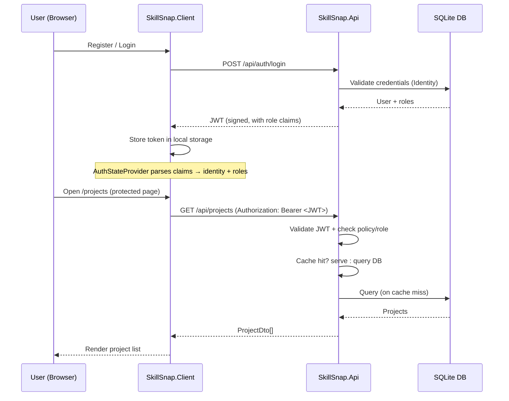
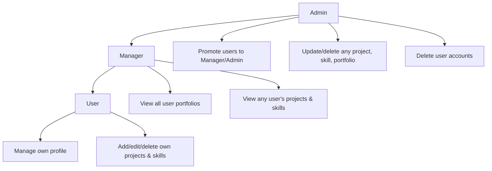

# SkillSnap

**SkillSnap** is a full-stack portfolio management application. Users create an account, build a personal portfolio, and showcase their **projects** and **skills**. Managers and Admins get elevated access to view all portfolios and manage users. The solution is built on **.NET 10** with a **Blazor WebAssembly** frontend, an **ASP.NET Core Web API** backend, and a shared class library for common models and DTOs.

## Solution Overview

The solution is split into three projects:

| Project | Type | Responsibility |
|---------|------|----------------|
| [SkillSnap.Api](SkillSnap.Api/README.md) | ASP.NET Core Web API | REST backend: authentication, authorization, data access, caching |
| [SkillSnap.Client](SkillSnap.Client/README.md) | Blazor WebAssembly | Browser SPA: UI, routing, auth state, API calls |
| `SkillSnap.Shared` | Class Library | Shared domain models and DTOs referenced by both ends |

```
SkillSnap.slnx
├── SkillSnap.Api/      → REST API (EF Core + SQLite, Identity, JWT)
├── SkillSnap.Client/   → Blazor WebAssembly SPA
└── SkillSnap.Shared/   → Shared models (PortfolioUser, Project, Skill) + DTOs
```

## Key Features

- **Authentication & JWT** — registration, login, and short-lived signed tokens issued by the API.
- **Role-based access** — three roles (`User`, `Manager`, `Admin`) enforced end-to-end.
- **Portfolio management** — each user manages a profile, projects, and skills.
- **Elevated views** — Managers/Admins browse all portfolios; Admins manage roles and accounts.
- **Performance** — server-side in-memory caching with per-user invalidation.
- **Security** — password rules, account lockout, rate-limited auth endpoints, CORS, and generic auth responses.

## Technology Stack

- **.NET 10** across all projects
- **Blazor WebAssembly** (client) with `Blazored.LocalStorage`
- **ASP.NET Core Web API** (server) with **EF Core** + **SQLite**
- **ASP.NET Core Identity** + **JWT bearer** authentication
- **OpenAPI** for API documentation (Development)

## Architecture



## Data Model



> Deleting a `PortfolioUser` cascades to its `Project` and `Skill` records. An Identity `ApplicationUser` is linked one-to-one with a `PortfolioUser` via `ApplicationUserId`.

## Authentication & Request Flow



## Role-Based Capabilities



## Getting Started

### Prerequisites

- [.NET 10 SDK](https://dotnet.microsoft.com/)

### 1. Run the API

```bash
# Apply migrations / create the database
dotnet ef database update --project SkillSnap.Api

# Start the API
dotnet run --project SkillSnap.Api
```

Then seed demo data with a `POST` to `/api/seed` (runs only once, when the database is empty).

### 2. Run the Client

Ensure `ApiBaseUrl` in `SkillSnap.Client/wwwroot/appsettings.json` points to the running API, and that the API's `Cors:AllowedOrigins` includes the client origin.

```bash
dotnet run --project SkillSnap.Client
```

### Demo Admin Credentials (after seeding)

- **Username:** `jordan@skillsnap.dev`
- **Password:** `AdminTad#12345`

## Project Documentation

- [SkillSnap.Api README](SkillSnap.Api/README.md) — endpoints, security, configuration
- [SkillSnap.Client README](SkillSnap.Client/README.md) — pages, workflow, page-flow diagram

## Security Notes

- The JWT signing key in `appsettings.json` is a development placeholder. Use User Secrets, environment variables, or a key vault for real deployments.
- Tokens are short-lived and validated on every request; the client clears expired tokens and redirects to login.
