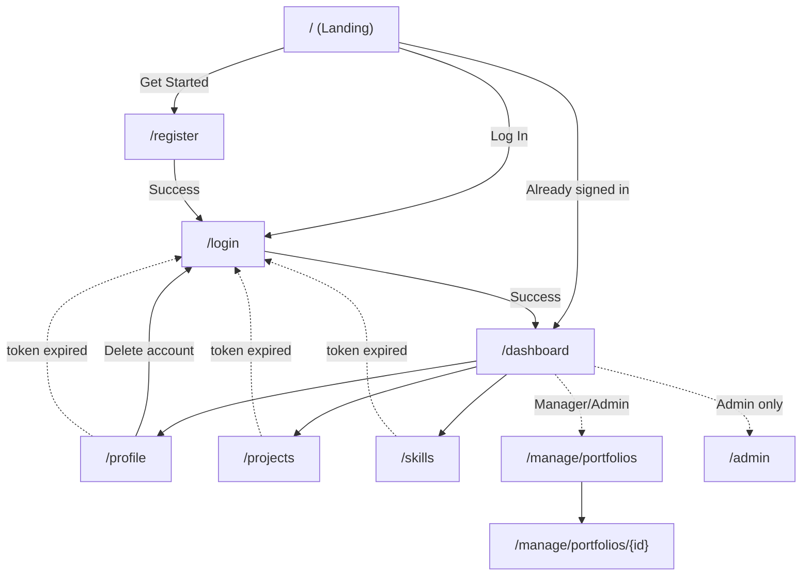

# SkillSnap.Client

The frontend for **SkillSnap**, a single-page portfolio application built with **Blazor WebAssembly** (`net10.0`). It lets users register, sign in, and manage their portfolio — profile, projects, and skills — while giving Managers and Admins elevated views and controls. The client talks to [SkillSnap.Api](../SkillSnap.Api/README.md) over HTTP, authenticating every request with a JWT bearer token.

## Overview

`SkillSnap.Client` is a standalone WebAssembly app that renders entirely in the browser. It stores the JWT returned by the API in browser local storage, rebuilds the user's identity and roles from that token, and uses Blazor's authorization system to gate pages and navigation by role.

## Tech Stack

- **Framework:** Blazor WebAssembly (.NET 10)
- **Auth:** JWT bearer tokens + `AuthenticationStateProvider`
- **Storage:** `Blazored.LocalStorage` for token persistence
- **HTTP:** `HttpClient` with a `DelegatingHandler` that attaches the bearer token
- **Shared:** References `SkillSnap.Shared` for models and DTOs

## Key Features

- **Authentication flow** — register, log in, and log out; token stored in local storage and auto-expired client-side.
- **Role-aware UI** — navigation and pages adapt to `User`, `Manager`, and `Admin` roles via `<AuthorizeView>` and `[Authorize]`.
- **Portfolio management** — edit your profile, and add/edit/delete your own projects and skills.
- **Manager/Admin views** — browse all user portfolios and drill into any user's projects and skills.
- **Admin controls** — promote users to Manager/Admin and delete accounts.
- **Automatic token handling** — a delegating handler injects the JWT into every API call; expired tokens redirect to login.

## Project Structure

```
SkillSnap.Client/
├── Auth/
│   ├── AuthTokenHandler.cs             # Attaches JWT as Bearer on every request
│   ├── JwtAuthenticationStateProvider.cs # Builds auth state from the stored token
│   └── RedirectToLogin.razor           # Sends unauthenticated users to /login
├── Components/                         # Reusable UI (ProjectCard, SkillBadge, UserMenu, etc.)
├── Layout/
│   ├── LandingLayout.razor             # Layout for public pages
│   ├── MainLayout.razor                # Layout for authenticated app
│   └── NavMenu.razor                   # Role-aware navigation
├── Pages/                              # Routable pages (see table below)
├── Services/                           # API client services (Auth, Project, Skill, Admin, etc.)
├── App.razor                          # Router + auth integration
└── Program.cs                         # DI registration, HttpClient, auth wiring
```

## Pages & Routes

| Page | Route | Access | Purpose |
|------|-------|--------|---------|
| `Landing` | `/` | Public (redirects if signed in) | Marketing hero + entry points |
| `Register` | `/register` | Public | Create a new account |
| `Login` | `/login` | Public | Sign in and receive a JWT |
| `Dashboard` | `/dashboard` | Authenticated | Hub linking to portfolio areas |
| `Profile` | `/profile` | Authenticated | Edit own profile; delete account |
| `ProjectList` | `/projects` | Authenticated | View/add/delete own projects |
| `SkillTags` | `/skills` | Authenticated | View/add/delete own skills |
| `ManagePortfolios` | `/manage/portfolios` | Manager, Admin | List all user portfolios |
| `ManagePortfolioDetail` | `/manage/portfolios/{id}` | Manager, Admin | View a user's profile, projects, skills |
| `Admin` | `/admin` | Admin | Promote roles; delete accounts |
| `NotFound` | (fallback) | Public | 404 fallback |

## Authentication Workflow

1. A user **registers** (`/register`), which calls `POST /api/auth/register`, then is redirected to **login**.
2. On **login** (`/login`), `AuthService` calls `POST /api/auth/login` and stores the returned JWT in local storage.
3. `JwtAuthenticationStateProvider` parses the token's claims (including roles) to establish the user's identity.
4. `AuthTokenHandler` attaches the token as a `Bearer` header on every subsequent API request.
5. Protected pages check `[Authorize]`/roles; unauthenticated users hit `RedirectToLogin` and are sent to `/login`.
6. On **logout** or **token expiry**, the token is cleared and the user returns to the anonymous state.

## Page Flow Diagram



> Solid arrows are the primary user flow; dotted arrows show role-gated navigation and the redirect-to-login path triggered when a token is missing or expired.

## Configuration

Set the backend API endpoint via `ApiBaseUrl` in `wwwroot/appsettings.json`. Program startup throws if it is not configured.

```json
{
  "ApiBaseUrl": "https://localhost:7001/"
}
```

## Getting Started

```bash
# Restore and build
dotnet restore
dotnet build

# Run the client (ensure SkillSnap.Api is running and ApiBaseUrl points to it)
dotnet run --project SkillSnap.Client
```

Make sure the API's `Cors:AllowedOrigins` includes this client's origin so browser requests are allowed.
